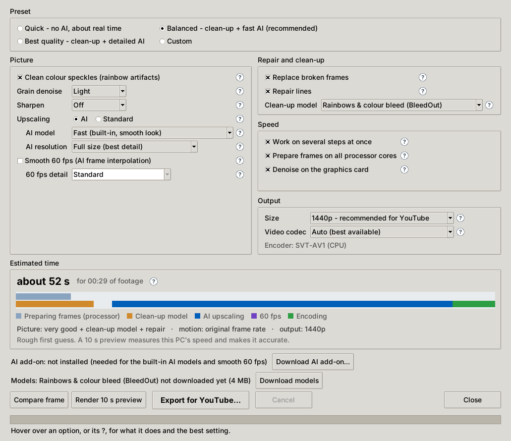

# FPV DVR Stitcher

A Windows app for **analog FPV DVR footage**. Pick the clips your goggles or handheld
receiver recorded during a session (SD 3-minute clips or one long HD-mode file), and it:

- **joins them into one video**, in order, with no seams between clips;
- **cuts out the pure static** recorded while the quad was powered off
  (battery swaps, before the first pack, after the last one);
- **trims the post-flight Betaflight STATS screen** shown between disarming and
  unplugging the battery;
- **keeps weak, breaking-up signal**, which looks different from dead static
  and is exactly what you need when looking for a crashed or lost quad;
- **flags suspicious signal losses** (signal faded before it was lost = out of
  range or crash) and can save a report with the last clear frame, the frames
  before it, and a lossless clip of the last 20 seconds;
- **keeps the original quality**: frames are copied byte-for-byte, never
  re-encoded. Audio is removed;
- **lets you fine-tune every cut**: drag a cut on the timeline or type its time, split
  parts, play the result as it will be exported, undo;
- **chapters**: one per flight plus your own, written into MKV / MP4 exports and saved as a
  list ready to paste into a YouTube description;
- **Enhance for YouTube**: optional second export that replaces broken frames and
  fills in streaks from breakup, cleans up rainbow colour noise and grain (optionally with a
  clean-up AI model for analog video), upscales to 1440p (standard or AI on the graphics
  card), can smooth to 60 fps (RIFE), and encodes on the GPU, with every stage running in
  parallel where it can.

## Download

Go to **[Releases](../../releases/latest)** and download:

- **`FPV-DVR-Stitcher.exe`**: a single file with everything built in. Download it and run it.
  It takes a few seconds to open because it unpacks FFmpeg each time. The AI add-on
  (about 70 MB) is downloaded the first time you use AI upscaling or 60 fps, and each
  clean-up / extra upscaling model (1-45 MB) the first time it is used.
- **`FPV-DVR-Stitcher-windows.zip`**: the same program with FFmpeg and the AI add-on as
  separate files. It starts faster. Unzip it and run `FPV DVR Stitcher.exe`.

No install and no Python needed. Windows SmartScreen may warn the first time because
the .exe isn't code-signed: click **More info -> Run anyway**.

Every push to `main` also builds everything automatically. The builds can be downloaded
from the **Artifacts** section of the latest run on the [Actions](../../actions) tab (you
need to be signed in to GitHub). To publish a new version, go to
**Releases -> Draft a new release**, create a new tag such as `v1.3.0` and click
**Publish**. The build attaches the downloads to the release within a few minutes.

## Using it

1. **Add files...** (all the `VIDxxxxx.AVI` clips from the session) or **Add folder...**.
   Clips play in file-name order. You can also drag clips onto the .exe.
2. **Analyse**. A 30-minute session takes about a minute.
3. Check the timeline. Green is good signal, orange is weak signal (always kept),
   red is static and purple is the STATS screen. The lower lane shows what goes into
   the export. Click the timeline or a row to preview a frame, and double-click a row
   to switch it between Keep and Cut.
4. Fine-tune if you like (below).
5. **Export video...** as AVI (same format as the originals) or MKV (with chapter
   markers), and/or **Enhance for YouTube...** for an upload-ready MP4.

### Editing, playing and chapters

- **Preview player:** Space plays; frame step, ½× to 8×, **As exported** (only the kept
  parts, joined like the export) or **Original**; a larger window (⤢ or double-click the
  picture). The list and the timeline follow the playback.
- **Move a cut:** drag the edges of the black box on the timeline (the preview shows the
  frame at the cut, the neighbouring part follows; then ←/→ nudge it a frame, Shift a
  second), or double-click a Start/End time in the list and type it. Mouse wheel zooms the
  timeline, Shift+wheel moves along it.
- **Edit menu / right-click:** set start or end at the playhead (I / O), split (S),
  cut/keep (X), play 3 s around a cut (P), add a chapter (C), chapters, zoom, undo
  (Ctrl+Z), reset to the detected cuts.
- **Chapters:** every flight gets one (green flags above the timeline); add your own (purple)
  and rename any in **Edit > Chapters...**. YouTube reads chapters only from the video's
  description, so **Copy for YouTube** gives the list in its format and checks YouTube's rules
  (first at 00:00, at least 3, each at least 10 s). MKV and MP4 exports get the chapter
  markers, and every export saves the list as `..._chapters.txt`.

Defaults: cut static longer than 1 s, keep 0.0 s of static at each cut, static = 95%
snow coverage, faint-picture protection on, STATS trim on, AVI output, report off.
See [README.txt](README.txt) for what each setting does.

If detection looks wrong on your footage, use **Help > Save diagnostics...** after
analysing. It saves one zip, usually 10-25 MB, containing the detector's measurements for
every frame and a selection of original frames from around each start and stop of the
signal. Sharing that zip is enough to tune the detector to your receiver.

## Enhance for YouTube

| Preset | What it does |
|---|---|
| Quick | No AI. Repair, colour-speckle clean-up, light denoise, sharpening, standard upscale to 1440p. About real time. |
| Balanced (default) | Repair, the **BleedOut** clean-up model, then the **Fast** AI model (realesr-animevideov3) on the graphics card. |
| Best quality | The same with the **Detailed** AI model (Real-ESRGAN x4plus). Sharpest, slowest. |

**Repair and clean-up** (new in 1.3):

- **Replace broken frames:** frames that came out torn, rolled or blown out by breakup, while
  the frames either side are fine, are found by comparing each frame with its neighbours
  (only where the analysis saw weak signal) and replaced: redrawn as in-between frames with
  RIFE in AI / 60 fps exports, otherwise by the nearest good frame. Runs longer than 6 frames
  are real breakup and stay in.
- **Repair lines:** short-lived bands of rainbow colour noise and streak lines across the
  picture are filled in from the rows above and below; the OSD is left alone.
- **Clean-up model** and more **AI models**, run with ONNX Runtime (DirectML) on any DirectX 12
  graphics card and downloaded from the releases when first used. There are no models trained
  on FPV footage; these are free community models trained for analog / VHS / composite video,
  which has the same faults:

  | Model | Kind | Author, licence |
  |---|---|---|
  | Rainbows & colour bleed ([1x-BleedOut-Compact](https://openmodeldb.info/models/1x-BleedOut-Compact)) - recommended | clean-up | zarxrax, WTFPL |
  | Dot crawl & rainbows ([1x-Dotzilla-Compact](https://openmodeldb.info/models/1x-Dotzilla-Compact)) | clean-up | zarxrax, WTFPL |
  | Heavy clean-up ([1x-Archivist_AntiLines](https://github.com/Loganavter/Archivist-Project-Denoiser)) | clean-up | Loganavter, MIT |
  | Heavy colour noise ([1x-Archivist_RGB](https://github.com/Loganavter/Archivist-Project-Denoiser)) | clean-up | Loganavter, MIT |
  | General x4 - smooth / keeps texture ([realesr-general-x4v3](https://github.com/xinntao/Real-ESRGAN)) | upscaler | Xintao Wang, BSD-3-Clause |
  | VHS to HD x2 ([2x-VHS2HD-RealPLKSR](https://openmodeldb.info/models/2x-VHS2HD-RealPLKSR)) | upscaler | asterixcool, CC-BY-SA-4.0 |

  The build converts them from PyTorch to ONNX (`tools/convert_models.py`) and attaches
  `model-<name>.onnx` files to each release.

Every option has a hover explanation (or click its **?**) with its quality and speed trade-off and the
recommended setting. Options:

- **Picture:** colour speckles, grain denoise (Off/Light/Medium/Strong), sharpen, AI or standard upscaling,
  AI model, **AI resolution** (full size, or 1080p then scaled up: about 45% less AI work),
  **Smooth 60 fps** (RIFE; also in the Enhance menu) and **60 fps detail** (Standard or the slower High-detail).
- **Speed:** **work on several steps at once** (frames are prepared, AI-upscaled and encoded in parallel),
  **prepare frames on all processor cores** (also splits the Quick export into parallel parts), and
  **denoise on the graphics card** (Medium/Strong via Vulkan, with automatic fallback to the processor).
- **Output:** 1080p / 1440p (recommended: YouTube encodes 1440p uploads better) / 4K, and the video codec.
  Encoding uses NVIDIA NVENC, AMD AMF or Intel QSV when available, with CPU fallbacks.

The finished MP4 carries the chapter markers, and the chapter list is saved next to it.
The **estimated time** panel shows how long the export will take and what runs on the processor and the
graphics card. The speed of each stage is measured on every preview and export and remembered, so the
estimate (and the time left while exporting) fits the PC. **Compare frame** shows a before/after picture;
**Render 10 s preview** renders a short sample (and measures the speed). Settings are remembered between runs.

## How static is told apart from weak signal

Measured on real analog DVR recordings:

| | Pure static (VTX off) | Weak signal | Good signal |
|---|---|---|---|
| Frame regions that are fine-grained noise | 92-100% | partial | partial (detailed scenes) |
| Colour | none | receiver drops it | yes |
| About 1 s of frames averaged together | averages away (ratio ~1.0) | scene and OSD survive (~2) | strong (>10) |

A frame counts as **no signal** only when snow covers almost all of it. Weak signal is
marked by colour loss, because analog receivers drop the colour when the signal gets
weak. The averaging test is a safety net: a picture or OSD hiding under heavy noise, such
as a crashed quad in the grass with a broken antenna, is kept even if every frame looks
like snow. If the picture faded through weak signal before turning to static, the loss
gets a warning; an unplugged VTX goes from a clean picture straight to static.

The STATS screen is found from a map of OSD-like text in each frame: the program learns
the STATS layout from the frames just before the power-offs in the recording (with a
built-in Betaflight pattern as a fallback) and trims the stretch where it is showing.

## Building it yourself

- `build.bat` (Windows, needs Python 3) builds `dist\FPV DVR Stitcher.exe` and
  downloads FFmpeg next to it. The AI add-on is downloaded by the app when first used.
- `run.bat` runs it straight from source.
- `python dvr_core.py VID*.AVI -o out.avi --report` is a command-line version.
  Add `--diagnostics diag.zip` (or `--dump frames.csv`) to save the measurements for tuning.
- `python tests/smoke_test.py` runs the end-to-end self-test. It builds a fake DVR
  session with static, flights, dropouts, STATS screens and a broken frame, then checks
  detection, chunked analysis, byte-identical export, editing, chapters, diagnostics,
  broken-frame replacement, ONNX models (with `pip install onnx`) and the enhance export.

Files:

| File | Contents |
|---|---|
| `dvr_core.py` | Analysis, classification, STATS detection, lossless export (FFmpeg stream copy), report, diagnostics |
| `enhance.py` | Enhance for YouTube pipeline (filters, AI upscale, 60 fps, GPU encoding, parallel/overlapped stages, speed estimates) |
| `fpv_dvr_stitcher.py` | The Tkinter desktop app (timeline editing, menus, shortcuts) |
| `player.py` | The preview player |
| `chapters_ui.py` | The Chapters window |
| `repair.py` | Broken-frame replacement and line repair |
| `models.py` | Clean-up / upscaling model catalog, downloads, ONNX Runtime runner |
| `enhance_ui.py` | The Enhance for YouTube window (hover help, estimate panel) |
| `tools/convert_models.py` | Converts the catalog's models to ONNX (used by the build) |
| `tests/smoke_test.py` | End-to-end self-test |
| `.github/workflows/build.yml` | Converts the models, Windows build: test, build both .exe versions, assemble the AI add-on, test the .exe files, attach to releases |

The bundled `ffmpeg.exe`/`ffprobe.exe` come from
[BtbN/FFmpeg-Builds](https://github.com/BtbN/FFmpeg-Builds) (LGPL build); their license
is included in the zip download as `FFMPEG-LICENSE.txt`. The AI add-on contains
[Real-ESRGAN ncnn-vulkan](https://github.com/xinntao/Real-ESRGAN) (BSD-3-Clause) and
[RIFE ncnn-vulkan](https://github.com/nihui/rife-ncnn-vulkan) (MIT). The program uses
[ONNX Runtime](https://github.com/microsoft/onnxruntime) (MIT) and
[Pillow](https://python-pillow.org) (MIT-CMU); the downloadable models are listed above with
their licences.
