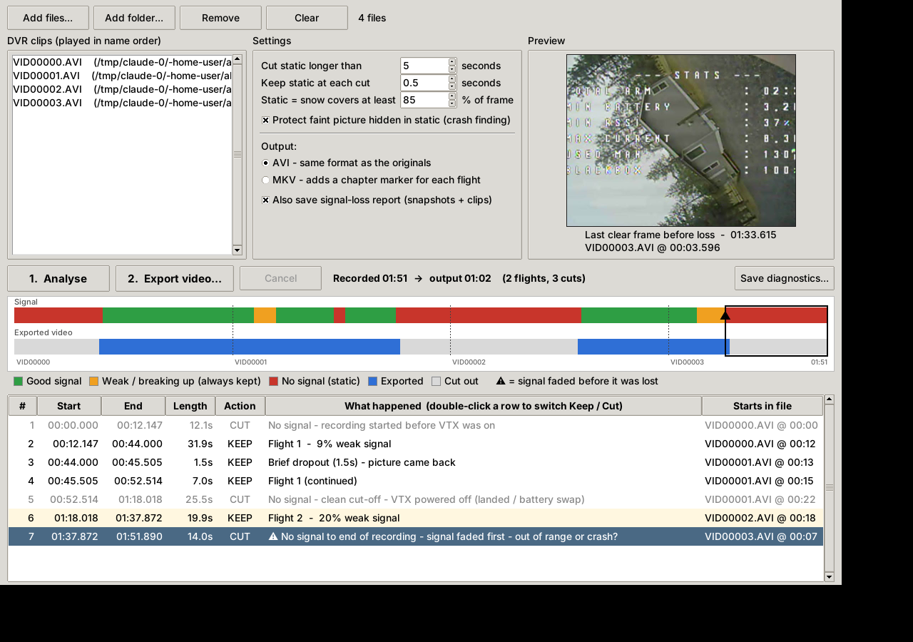

# FPV DVR Stitcher

A Windows app for **analog FPV DVR footage**. Pick all the 3-minute clips your
goggles or handheld receiver recorded during a session, and it:

- **joins them into one video**, in order, with no seams between clips;
- **cuts out the pure static** recorded while the quad was powered off
  (battery swaps, before the first pack, after the last one);
- **keeps weak, breaking-up signal**, which looks different from dead static
  and is exactly what you need when looking for a crashed or lost quad;
- **flags suspicious signal losses** (signal faded before it was lost = out of
  range or crash) and can save a report with the last clear frame, the frames
  before it, and a lossless clip of the last 20 seconds;
- **keeps the original quality**: frames are copied byte-for-byte, never
  re-encoded. Audio is removed.

## Download

Go to **[Releases](../../releases/latest)** and download either file:

- **`FPV-DVR-Stitcher.exe`**: a single file with everything built in. Download it and run it.
  It takes a few seconds to open because it unpacks FFmpeg each time.
- **`FPV-DVR-Stitcher-windows.zip`**: the same program with FFmpeg as separate files. It
  starts faster. Unzip it and run `FPV DVR Stitcher.exe`, keeping `ffmpeg.exe` and
  `ffprobe.exe` next to it.

No install and no Python needed. Windows SmartScreen may warn the first time because
the .exe isn't code-signed: click **More info -> Run anyway**.

Every push to `main` also builds both automatically. They can be downloaded from the
**Artifacts** section of the latest run on the [Actions](../../actions) tab (you need
to be signed in to GitHub). To publish a new version, go to **Releases -> Draft a new release**,
create a new tag such as `v1.0.1` and click **Publish**. The build attaches both downloads
to the release within a few minutes.

## Using it

1. **Add files...** (all the `VIDxxxxx.AVI` clips from the session) or **Add folder...**.
   Clips play in file-name order. You can also drag clips onto the .exe.
2. **Analyse**. A 30-minute session takes about a minute.
3. Check the timeline. Green is good signal, orange is weak signal (always kept),
   red is static. The lower lane shows what goes into the export. Click the
   timeline or a row to preview a frame, and double-click a row to switch it
   between Keep and Cut.
4. **Export video...** as AVI (same format as the originals) or MKV (adds a
   chapter marker for each flight).

See [README.txt](README.txt) for what each setting does.

If detection looks wrong on your footage, press **Save diagnostics...** after analysing.
It saves one zip, usually 10-25 MB, containing the detector's measurements for every
frame and a selection of original frames from around each start and stop of the signal.
Sharing that zip is enough to tune the detector to your receiver, with no full videos needed.

## How static is told apart from weak signal

Measured on real analog DVR recordings:

| | Pure static (VTX off) | Weak signal | Good signal |
|---|---|---|---|
| Frame regions that are fine-grained noise | 92-100% | 35% or less | 31% or less |
| About 1 s of frames averaged together | Averages away (ratio ~1.0) | Scene and OSD survive (~2) | Strong (>10) |
| Horizontal tearing | - | Yes | No |

A frame counts as **no signal** only when snow covers almost all of it. The
averaging test is a safety net: a picture or OSD hiding under heavy noise, such
as a crashed quad in the grass with a broken antenna, is kept even if every
frame looks like snow. Only static runs longer than a set time (default 5 s)
are cut, so brief dropouts mid-flight stay in. If the picture faded through
weak signal before turning to static, the loss gets a warning. An unplugged
VTX goes from a clean picture straight to static.

## Building it yourself

- `build.bat` (Windows, needs Python 3) builds `dist\FPV DVR Stitcher.exe` and
  downloads FFmpeg next to it.
- `run.bat` runs it straight from source.
- `python dvr_core.py VID*.AVI -o out.avi --report` is a command-line version.
  Add `--diagnostics diag.zip` (or `--dump frames.csv`) to save the measurements for tuning.
- `python tests/smoke_test.py` runs the end-to-end self-test. It builds a fake
  DVR session, then checks detection and that the export is byte-identical.

Files:

| File | Contents |
|---|---|
| `dvr_core.py` | Analysis, classification, lossless export (FFmpeg stream copy), report |
| `fpv_dvr_stitcher.py` | The Tkinter desktop app |
| `tests/smoke_test.py` | End-to-end self-test |
| `.github/workflows/build.yml` | Windows build: test, build both .exe versions, test them, attach to releases |

The bundled `ffmpeg.exe`/`ffprobe.exe` come from
[BtbN/FFmpeg-Builds](https://github.com/BtbN/FFmpeg-Builds) (LGPL build). Their
license is included in the zip download as `FFMPEG-LICENSE.txt`.
